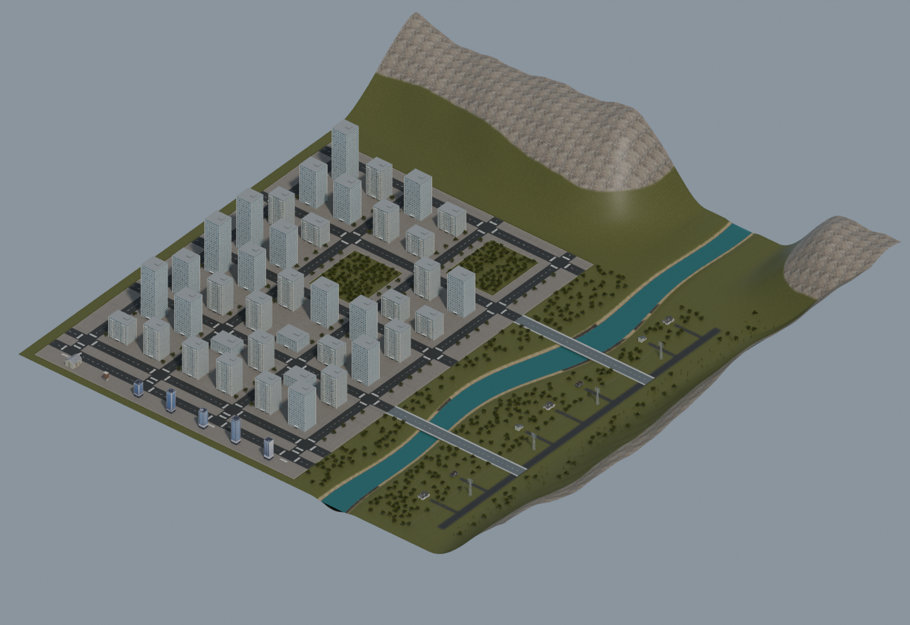

# 三个 1 km 场景的使用与编辑

本指南对应仓库内三个正式 Gazebo Classic 11 世界。它们的模型、碰撞网格和运行贴图随仓库分发，通过 `model://` 与仓库相对路径引用。运行时不需要作者的个人模型缓存，也无需下载模型数据库资源。三个世界仅提供环境，不会自动生成无人机、传感器或飞控。

## 1. 场景与文件

| 命令别名 | 正式名称 | 主要内容 | 地形高度范围（约，米） |
|---|---|---|---|
| `snow` | `alpine_snow_1km` | 雪山、裸岩、泥地、草地与两处冻结湖面；地形采样中的雪区约 78.19% | 7.27～150.03 |
| `mountain` | `mountain_lakes_1km` | 山坡、双湖、沙岸、泥岸与成片树林 | 10～216.084 |
| `city` | `urban_river_1km` | 城区、住宅、道路、两座桥、河流、树林、山地和原创输电走廊 | -1～138.201 |

三个场景采用米制世界坐标，地形范围约为 `x、y ∈ [-500, 500]`，Z 向上。表中的范围是地形表面/湖床高程，不包含楼顶、树冠和输电塔顶；某些边界资产可能伸出地形范围。它们是构造场景，没有绑定真实地理坐标或海拔基准。

```text
仓库根目录/
├── scripts/
│   ├── scene_env.sh                 # source 后设置本终端的资源搜索路径
│   ├── prepare_scenes.sh            # 资产检查与本机插件编译
│   └── run_scene.sh                 # 独立 Gazebo 入口
├── worlds/
│   ├── worlds/<正式名称>.world      # 三个正式世界
│   ├── models/                      # 22 个运行模型目录
│   ├── plugins/LakeWaterPlugin.cc
│   ├── plugins/CMakeLists.txt
│   ├── .scene-build/                # 本机生成，不随 Git 分发
│   └── launch/scene.launch          # 可选 ROS 入口
├── scene_sources/<正式名称>/
│   ├── blender/<正式名称>.blend     # 可编辑场景，贴图打包在文件内
│   ├── source_textures/             # 原始贴图、来源与校验记录
│   ├── terrain_data.npz             # 地形采样资料
│   └── terrain_field.py 或 city_field.py
└── tools/
    ├── validate_scene_assets.py
    ├── export_blender.py
    └── generate_power_corridor.py
```

山湖和城市还保存 `forest_layout.json`；城市另外保存 `scene_layout.json`。模型目录数与世界实例数不同：同一个树、住宅或输电走廊模型会被复用。详细模型清单见 [model_inventory.json](model_inventory.json)。

下图是公开版城市的 Blender 离线预览（不是 Gazebo 截图），使用本仓库原创输电走廊。



[查看河流与输电走廊近景](urban_corridor_blender.png)

## 2. 最小依赖与准备

| 用途 | 所需组件 |
|---|---|
| 仅检查运行资源路径 | Python 3 标准库 |
| 运行雪山 | Bash、Gazebo **Classic 11** 及可用的图形环境 |
| 运行山湖/城市 | 上述组件，以及本机编译的 `libLakeWaterPlugin.so` |
| 编译水体插件 | C++17 编译器、CMake ≥ 3.10、pkg-config、Gazebo 11 开发文件 |
| ROS 接入 | ROS Noetic、`gazebo_ros`；其余按飞控/传感器需要安装 |
| 编辑或生成 Blender 工程 | Blender 4.5 LTS；导入脚本使用 Blender 自带的 `bpy`、NumPy |
| 在普通 Python 中调用地形函数 | Python 3 与 NumPy；基本运行不需要 NumPy |

Ubuntu 20.04 是本仓库历史工作流的参考环境。常见相关包名为 `gazebo11`、`libgazebo11-dev`、`build-essential`、`cmake`、`pkg-config`、`python3`；ROS 接入还需要 `ros-noetic-gazebo-ros`。请先在目标机器准备这些组件，启动脚本不会执行 `sudo`、联网安装或修改 `.bashrc`。新版 Gazebo Sim / Ignition 的插件接口不能直接替代 Classic 11。

以下命令均从克隆后的仓库根目录执行。本仓库的独立入口和 `scene.launch` 支持含空格的目录；外部 PX4 启动文件的兼容要求见第 6 节：

```bash
python3 tools/validate_scene_assets.py
./scripts/prepare_scenes.sh
```

检查器遍历这三个世界的 SDF、Collada、Ogre 材质及贴图引用，报告缺失文件、外部 URI 和非便携路径，并检查水体配置。退出码 `0` 表示这些静态检查通过；它不等同于完成渲染、碰撞或飞行验证，也不会检查其他历史世界。

准备脚本先执行该检查，再使用 `worlds/plugins/CMakeLists.txt` 编译水体插件，输出到 `worlds/.scene-build/libLakeWaterPlugin.so`。编译结果依赖本机 Gazebo ABI，换机器或系统后应重新编译。默认使用两个编译任务，可以用 `SCENE_BUILD_JOBS=1 ./scripts/prepare_scenes.sh` 调整。源文件更新后也应重新执行准备脚本；启动脚本只检查插件是否存在，不自动判断其是否过期。

## 3. 独立运行与环境变量

每次选择一个场景运行：

```bash
./scripts/run_scene.sh snow
./scripts/run_scene.sh mountain
./scripts/run_scene.sh city
```

正式名称同样可用，例如 `./scripts/run_scene.sh mountain_lakes_1km`。脚本自动设置资源环境；山湖或城市在插件缺失时会调用准备脚本，雪山不依赖该插件。

查看世界路径或传入 Gazebo 参数：

```bash
./scripts/run_scene.sh city --print-world
./scripts/run_scene.sh snow -- --verbose
```

`--print-world` 只打印绝对路径，不启动仿真、不编译插件，也不检查文件是否存在。`--` 后面的参数原样传给 Gazebo；引号可保留单个参数内的空格。

如需自行运行 `gzserver`、ROS 或飞控，在同一终端显式加载环境：

```bash
source ./scripts/scene_env.sh
world_file="$(./scripts/run_scene.sh mountain --print-world)"
gzserver --verbose "$world_file"
```

`scene_env.sh` 在存在时读取系统 Gazebo setup，并保留调用者的 `set -u` 设置。它向 `GAZEBO_MODEL_PATH` 加入仓库 `worlds/models`，向 `GAZEBO_PLUGIN_PATH` 加入 `worlds/.scene-build`，并补充系统资源目录及三个住宅的纹理目录。它保留已有路径，不更改当前工作目录；重复加载不会重复添加同一路径。独立启动脚本子进程中的环境不会传回父终端。

如果本机已有同名自定义模型，应确认 Gazebo 最终选中的是本仓库模型。避免同时用几个入口启动同一个 Gazebo master；需要切换场景时先正常退出当前实例。

## 4. 起飞参考位置

这些世界没有 `z=0` 的通用地面。无人机按空世界的默认高度生成时可能埋入地形；Gazebo 初始相机位置也不是无人机出生点。

| 场景 | 参考 `(x, y)`（米） | 该位置地面/路面 Z（约，米） | 示例无人机模型原点 Z（米） |
|---|---|---|---|
| 雪山 | `(0, 0)` | `18.49` | `19.5` |
| 山湖 | `(0, 0)` | `31.717` | `33` |
| 城市 | `(-290, -400)` | 路面 `8.02` | `9.5` |

示例 Z 留出了初始净空，**不是每一种无人机的准确接地高度**。生成高度应满足：`z_spawn = 地面高程 + 模型原点到最低碰撞点的垂直距离 + 初始净空`。悬挂传感器、起落架及机体原点不同都会改变该值。先暂停仿真检查模型最低点、附近障碍物和倾斜地面，再恢复物理与飞控；从有净空的位置释放后会发生正常落体/接地。

地形函数 `scene_sources/<场景>/terrain_field.py` 或 `city_field.py` 的 `terrain_height(x, y)` 可查询地形/湖床高度。它不包含建筑、树冠、桥面等独立模型；城市参考位置的路面还高于基础平台约 0.02 m。正式接地结果以 Gazebo 加载的碰撞网格为准。

## 5. ROS Noetic 接入（可选）

`worlds/` 是包名为 `my_gazebo_worlds` 的 ROS 功能包。无需移动资源，可在已配置 ROS 的终端临时把该包加入搜索路径：

```bash
source /opt/ros/noetic/setup.bash
repo_root="$PWD"  # 当前位于仓库根目录
source "$repo_root/scripts/scene_env.sh"
export ROS_PACKAGE_PATH="$repo_root/worlds:${ROS_PACKAGE_PATH:-}"
rospack find my_gazebo_worlds
roslaunch my_gazebo_worlds scene.launch scene:=mountain_lakes_1km paused:=true gui:=true
```

`rospack find` 应指向本次克隆的 `worlds/`。如果已有另一个同名包，先纠正包搜索路径，避免启动旧世界。也可在 catkin 工作空间的 `src/` 中建立指向本仓库 `worlds/` 的符号链接，使用源码/devel 工作流；此处不提供 catkin install 布局。

ROS 的 `scene` 参数接受完整文件名主体，例如 `alpine_snow_1km`，不接受 `snow` 别名或 `.world` 后缀。另有 `paused`、`gui`、`use_sim_time`、`verbose` 参数。无 GUI 示例：

```bash
roslaunch my_gazebo_worlds scene.launch scene:=urban_river_1km gui:=false verbose:=true
```

`scene.launch` 通过仓库内保留参数边界的启动脚本运行 Gazebo，加载 `gazebo_ros` 的 API 与路径插件，并设置模型、插件与纹理路径。它不会编译水体插件，山湖/城市应先运行 `prepare_scenes.sh`。该入口只启动环境；无人机需要由已有 ROS/PX4 工作流另行生成。

## 6. PX4 SITL 接入（可选）

如果使用 PX4 原有 launch，它可能调用 `gazebo_ros` 的旧 shell 包装脚本；该脚本会拆分含空格的环境路径。因此，**使用此 PX4 接入示例时请把仓库克隆到不含空格的目录**。本仓库的 `scene.launch` 已用独立包装器解决此问题，但不会改写外部 PX4 启动文件。

先按项目原有的 [环境搭建文档](../01_仿真环境搭建.md)配置可独立运行的 PX4 v1.13 / Gazebo Classic / MAVROS 环境。加载 ROS、PX4 和其 Gazebo 插件环境后，再加载本仓库 `scene_env.sh`，以保留飞控插件和本仓库资源路径。

在仓库根目录，先准备插件，然后向已有飞控 launch 传递世界与生成位置。例如，对提供标准 `world`、`x`、`y`、`z` 参数的 PX4 启动文件：

```bash
repo_root="$PWD"
source "$repo_root/scripts/scene_env.sh"
world_file="worlds/urban_river_1km.world"
roslaunch px4 mavros_posix_sitl.launch \
  "world:=$world_file" x:=-290 y:=-400 z:=9.5
```

这里的相对世界路径通过 `scene_env.sh` 设置的 `GAZEBO_RESOURCE_PATH` 解析，避免 ROS 上游 `gzserver` 包装脚本拆分含空格的绝对路径。切换山湖时使用 `worlds/mountain_lakes_1km.world`，并用 `x:=0 y:=0 z:=33`；雪山用 `worlds/alpine_snow_1km.world` 与 `x:=0 y:=0 z:=19.5`。根据所用机型原点和碰撞尺寸调整 Z。机型、传感器、MAVROS 接口以及 `vehicle`/`sdf` 等参数按已有 PX4 配置选择；不同分支或本地修改版 launch 的参数可能不同。

让 PX4 launch 负责创建 Gazebo 实例时，直接传 `world:=`，无需先运行独立 `run_scene.sh` 或 `scene.launch`。如果已有 launch 内部固定了世界文件或覆盖了资源环境变量，需要将其改为接受上述 world 参数并保留当前环境。本仓库不会自动修改 PX4 文件，也不会启动 MAVROS 或修复飞控版本差异。

## 7. 碰撞与物理范围

三个世界使用 ODE，当前设定 `max_step_size=0.001 s`、目标更新频率 `1000 Hz`、Quick solver 迭代数 `100`。目标频率不保证实时率为 1；树林、网格接触、传感器和水下采样会增加计算负担。

地表材质通过独立碰撞面设置接触参数。当前典型 `mu=mu2` 为：岩石 0.9、草地 0.75、泥地 0.45、沙地 0.6、湖床/河床 0.35；雪 0.65、冰 0.06；城市铺装 0.85、沥青 1.0。雪、泥、沙等还使用不同的接触刚度与阻尼。最终行为同时取决于接触双方的碰撞参数、模型质量、速度、时间步长及求解器，不能仅根据贴图粗糙度判断。

雪和泥的柔顺接触只是刚度/阻尼近似，不包含可永久变形地形、压实、轮辙、雪粒或土壤颗粒模型。冻结湖面是低摩擦固体，可承托碰撞体；裂纹属于视觉纹理，没有破冰或融化模拟。

### 山湖与河流

水面只有可视网格，没有可站立的水面碰撞体；湖床、河床及岸坡具有固体碰撞。`LakeWaterPlugin` 按多边形边界和上下水位，对动态刚体施加浮力、线性/二次阻力以及角阻尼。

| 水域 | 水面 Z（米） | 插件作用下边界 Z（米） |
|---|---|---|
| 山湖东侧主湖 | 22 | 10 |
| 山湖西侧次湖 | 26 | 18 |
| 城市河流 | 5 | -1 |

上述是世界坐标绝对高程。湖床真实形状由碰撞网格决定，插件的下边界不是处处等深的湖底。

当前水密度为 `1000 kg/m³`，每条 link 默认使用 `12³` 网格候选点估算碰撞体联合体积与浸没体积，重叠碰撞形状不会简单重复相加。盒、球、圆柱使用对应几何判断；一般网格采用 link 局部包围盒近似，空心物体、复杂机体或细长结构的排水体积可能失真。需要精确浮力时，应为测试物体提供合适的闭合基础形状碰撞并独立验证。

插件不模拟自由表面流体、波浪动力学、河流速度场、流固耦合、飞溅、进水或电机水下推力。水面视觉波纹不产生物理波浪；物体是否浮起取决于质量、排水体积和姿态，不是进入水域后就固定浮在表面。静态模型不会受到浮力，水下 UAV 的飞控与推进模型仍由其自身插件控制。

### 树木、建筑与输电走廊

树木和住宅保留上游碰撞定义；可见枝叶不意味着每片叶子都有等精度碰撞。建筑及道路按 SDF 中的碰撞形状参与接触。

城市放置两个原创 `uav_power_corridor` 实例，共四座约 32 m 高的格构塔；每条走廊含六相导线和两根顶部屏蔽线，采用有弧垂的静态网格及碰撞。它用于导航、视觉与障碍物测试，不模拟电场、电弧、杆塔弹性、线缆振动或断裂。细导线在高速、较大时间步长或简化碰撞下可能漏检，应结合实际无人机碰撞体和飞行速度检查。

## 8. Blender 与源数据

可直接打开 `scene_sources/<正式名称>/blender/<正式名称>.blend`。工程包含可编辑的视觉几何、材质和场景实例，图像已经打包；运行 Gazebo 不需要 Blender。Blender 和 Gazebo 的光照、透明度及渲染器不同，离线预览不能作为 Gazebo 截图或物理验证结果。

以当前 Gazebo 世界为准重建 Blender 场景：

```bash
blender --background --python tools/export_blender.py -- \
  --scene mountain_lakes_1km --no-render
```

该操作会覆盖对应 `.blend`，编辑前请自行另存版本。去掉 `--no-render` 还会生成离线预览到对应 `previews/`；导入记录写入 `validation/`。这两个输出目录是本机生成文件，默认不随 Git 提交。脚本的方向是 **Gazebo `.world`/SDF → Blender 视觉工程**；在 Blender 中直接编辑后不会自动回写 `.world`、碰撞网格或水域参数，也没有通用的反向物理导出。

修改运行场景时，应同时维护世界布局、可视网格、碰撞网格、材质引用与相应源数据。水域形状变化还需同步插件的多边形和水位；随后重新检查资产、按需编译插件，再在 Gazebo 中验证。原创输电模型可用 `python3 tools/generate_power_corridor.py` 重新生成；此命令会覆盖该模型的生成文件。

原始贴图及其 `SOURCES.md`、`sources.json` 保存在各场景 `source_textures/`。贴图来源、作者和许可见 [第三方内容声明](../../THIRD_PARTY_NOTICES.md)；OSRF 树和住宅采用 CC BY 3.0，需要保留署名，不能把整个 Blender 文件中的所有资产都视作 MIT。

## 9. 排查入口

| 现象 | 检查方法 |
|---|---|
| 模型/贴图缺失 | 先执行 `python3 tools/validate_scene_assets.py`，再检查本终端是否加载 `scene_env.sh`、是否有同名旧模型优先被找到 |
| 无法加载 `libLakeWaterPlugin.so` | 运行准备脚本；确认 `pkg-config --modversion gazebo` 是 11.x，且当前 `GAZEBO_PLUGIN_PATH` 包含本仓库 `.scene-build` |
| 换机器后插件加载失败 | 旧编译目录含绝对 CMake 缓存；将该本机生成目录移走后重新执行准备脚本，不要复用旧 `.so` |
| 房屋显示白色或纹理找不到 | 使用仓库入口以带上三个 `house_*/materials/textures` 搜索路径，检查材质文件是否齐全 |
| 无人机生成后落穿/弹飞 | 检查原点 Z、最低碰撞点、生成时的重叠、网格碰撞及时间步长；不要沿用空世界的 `z=0` |
| 水中物体像落在地板上 | 确认使用正式世界，水面没有被自行添加 collision；再检查是否已经到达真实湖床或河床 |
| 浮力缺失或不合理 | 检查插件日志、物体是否动态、质量与碰撞体形状、水域边界及采样近似 |
| 仿真较慢 | 先关闭 GUI 或减少传感器负载，观察实时率；改大物理步长前重新评估接触和细线碰撞 |
| ROS 找到了旧场景 | 查看 `rospack find my_gazebo_worlds` 和 `ROS_PACKAGE_PATH`，检查是否存在重复包名 |

静态依赖检查、插件编译、Gazebo 实际加载、物理测试和 PX4 飞行是不同验证层次。本指南提供复现入口与参数说明；请以目标机器运行时的输出和测试记录确认对应层次的结果。

## 10. 发布验证与复现

发布前使用新的 Git 克隆目录（路径含空格）、隔离的 HOME 和关闭模型数据库的环境测试，未借用作者的 `~/.gazebo/models`。Gazebo Classic 11.15.1 / ODE 下，三个世界各运行 20 秒：20 个动态探针覆盖雪、冰、岩石、草、泥、沙、道路、桥面、屋顶以及双湖/河流中的浮沉；另有 6 条射线检查建筑、桥面、河床、原创塔架和导线碰撞。插件由克隆中的源码重新编译。修复后的 `scene.launch` 还从含空格目录实际启动了 ROS/Gazebo，并通过 `/gazebo/get_world_properties` 确认雪地模型已加载。

结果见 [physics_validation.json](physics_validation.json) 与 [发布验证记录](release_validation.json)。Blender 4.5.14 LTS 打开三个克隆工程时，所有文件型图像均已内嵌。另从隔离克隆捕获了[城市 Gazebo 原生相机图像](urban_gazebo_clone.jpg)，与上方 Blender 预览分别保存。此验证不包含 PX4 闭环飞行或特定无人机水中动力学。

如需复现物理检查，在准备脚本完成后执行：

```bash
python3 tests/run_scene_physics.py
```

测试生成的临时世界、日志和 JSON 放在 `tests/output/`，不修改正式世界，默认使用独立 Gazebo master 端口 11635～11637；可用 `--port` 更改起始端口。GitHub 自动检查仅执行静态资源检查和脚本语法检查；物理测试需要本机 Gazebo 开发环境。
